# Liquid Launcher

A real Android launcher (you can set it as your default Home app) that recreates the **iOS 26 / iOS 27 Home Screen** and its **Liquid Glass** design, written in Kotlin and Jetpack Compose.

<p>
  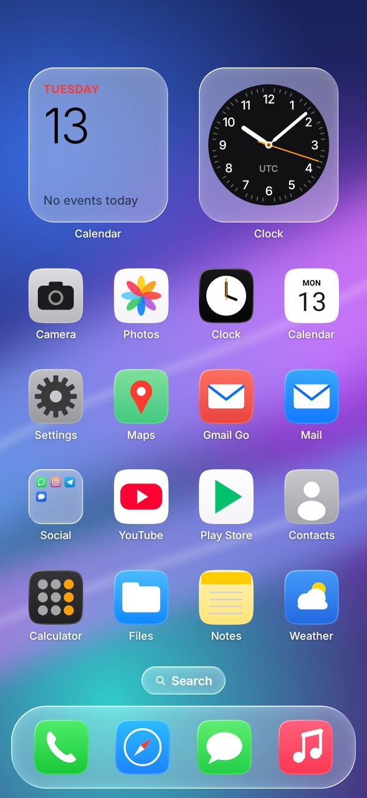
  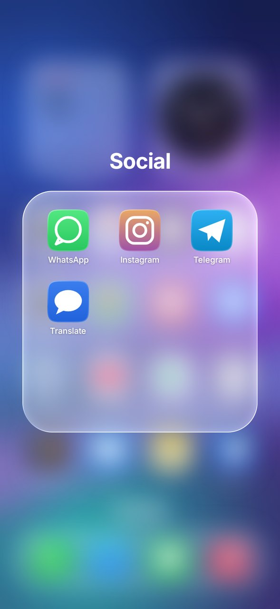
  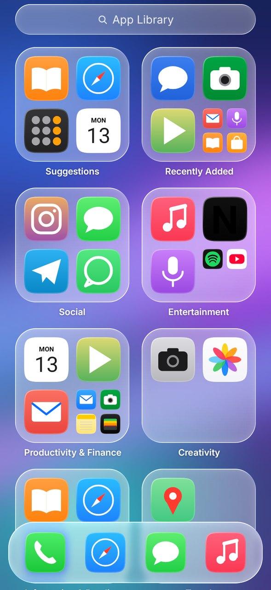
</p>

## Real Liquid Glass

The glass isn't a flat translucent fill. Every floating surface — the dock, the Search pill, folders, menus, Spotlight, alerts and the Edit / Done buttons — redraws **what is actually behind it**:

1. The Home Screen (wallpaper, pages, icons) is recorded each frame into a GPU layer.
2. Each glass panel draws its slice of that layer through a **GPU blur** (Android 12+).
3. On Android 13+ an **AGSL shader** then bends the image at the rim like a lens (with a hint of chromatic split), tints it, and adds a **specular edge light** that catches the top-left and bottom-right like iOS.

So icons scrolling under the dock in the App Library blur and warp through it, and a page shows through an open folder. Surfaces that sit straight on the wallpaper (widgets, App Library boxes) use a pre-blurred wallpaper with the same lens shader. Older phones fall back to frosted glass.

The **Liquid Glass slider** from iOS 27 is in *Launcher Settings → Icons & Liquid Glass*: slide left for clear glass, right for more tint.

## Features

- **Home Screen** — 4×6 (or 5×6) pages, squircle icons, labels, the iOS 26 glass **Search** pill that turns into page dots while you swipe, glass **dock**.
- **Jiggle mode** — long-press empty space (or long-press an icon and move). Drag to rearrange, hold at the screen edge to change page, drop an app on another to make a **folder**, drag into / out of the dock and folders. Edit menu with **Add Widget**, **Customize**, **Edit Wallpaper**, plus **Undo / Redo** (an iOS 27 addition).
- **Long-press menus** — app shortcuts, Edit Home Screen, Share, App Info, Remove App; iOS-style remove alert (Remove from Home Screen keeps it in the App Library, or Delete App).
- **Folders** — glass tile with a 3×3 preview, zooms open, rename in edit mode, paged when full.
- **Widgets** — Clock (analog), World Clock (day/night faces), Calendar, Month, Batteries.
- **Today View** — swipe right from the first page.
- **App Library** — swipe past the last page: Suggestions, Recently Added and automatic categories; tap the search field for an A–Z list with a letter scrubber.
- **Spotlight** — swipe down on the Home Screen: Siri-style suggestions, app search, a built-in **calculator** (`12*4+2` → 50) and web search. Swipe from the very top edge for notifications.
- **Icon styles** — Default, Dark, Tinted (pick the colour) and Clear (frosted glass icons).
- **Wallpapers** — 8 built-in iOS 26-style gradient wallpapers with dark variants, your own photo, or the system wallpaper; optionally set it as your Lock Screen too.
- **Notification badges** — red count badges (needs notification access).
- Opening apps zooms out from the icon; Back and Home close whatever is open; work-profile apps are supported.

<p>
  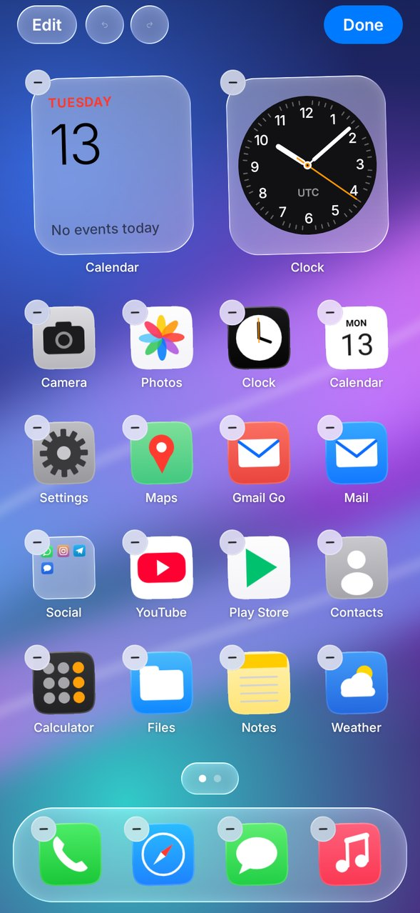
  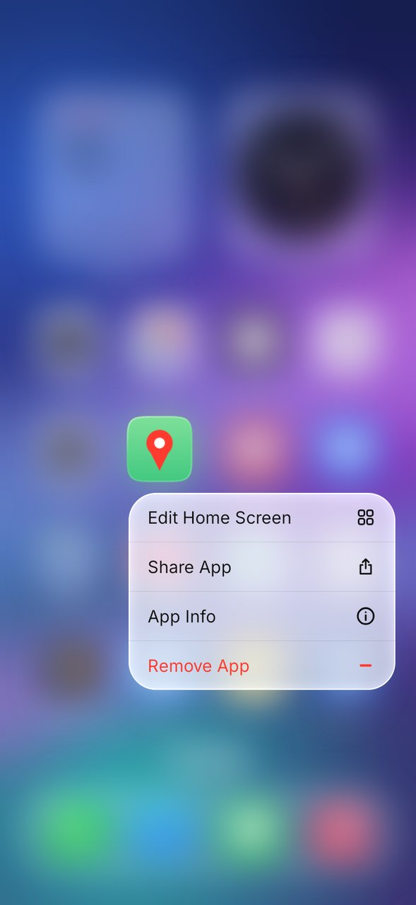
  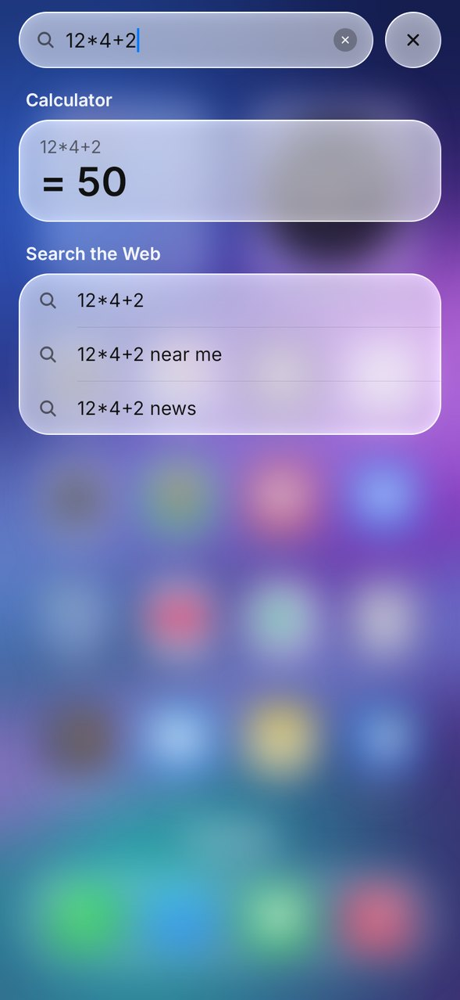
  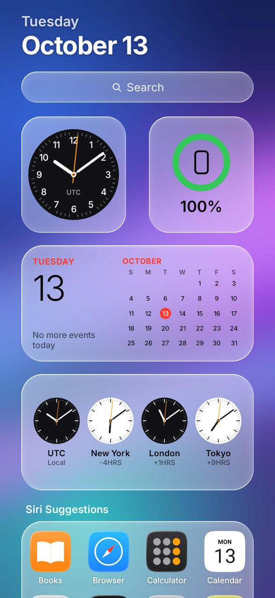
</p>
<p>
  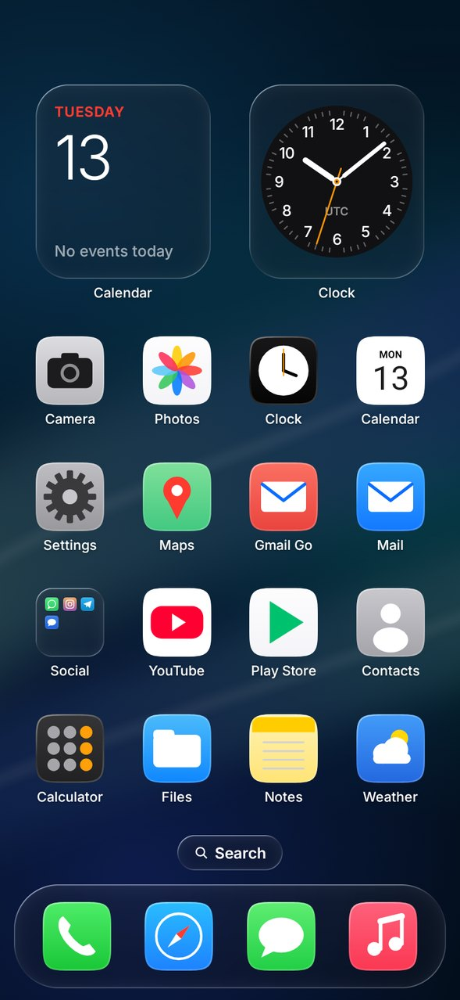
  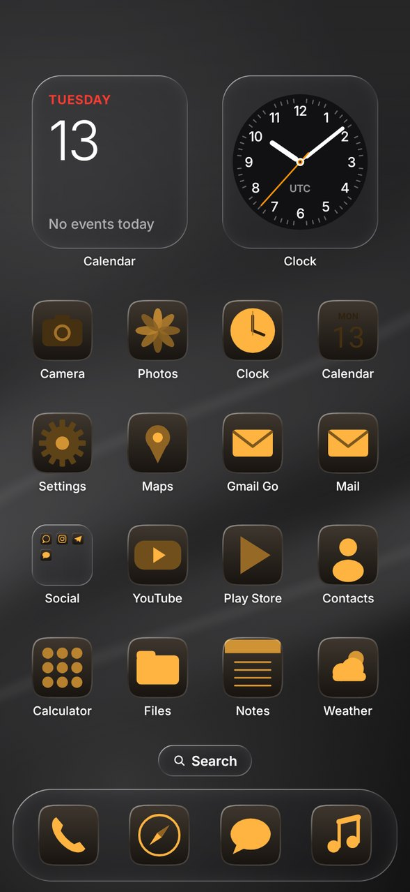
  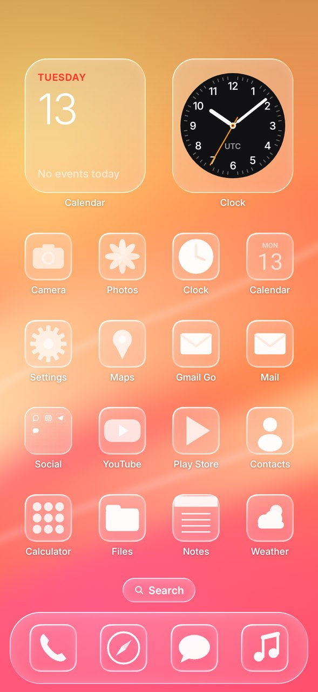
  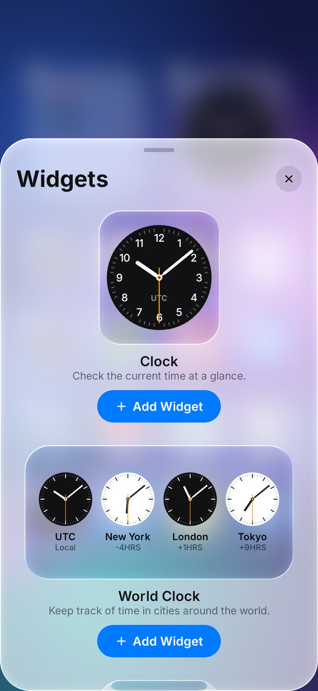
</p>
<p>
  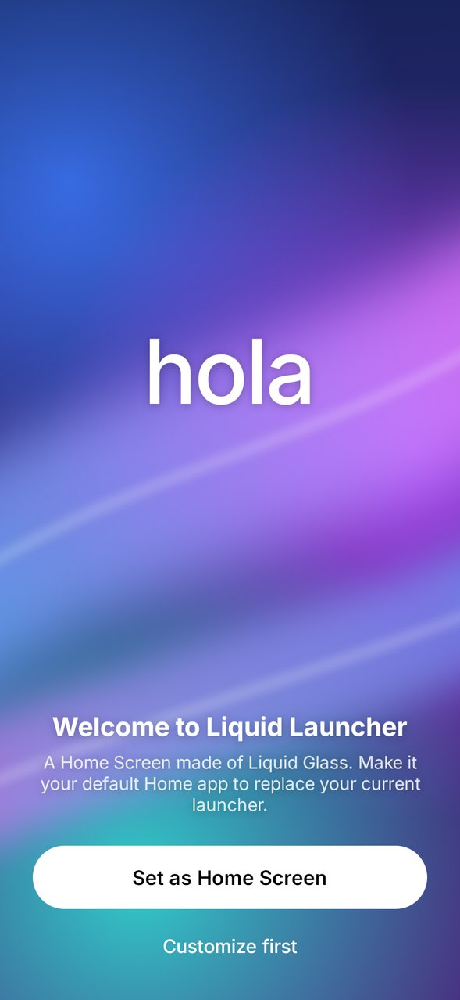
  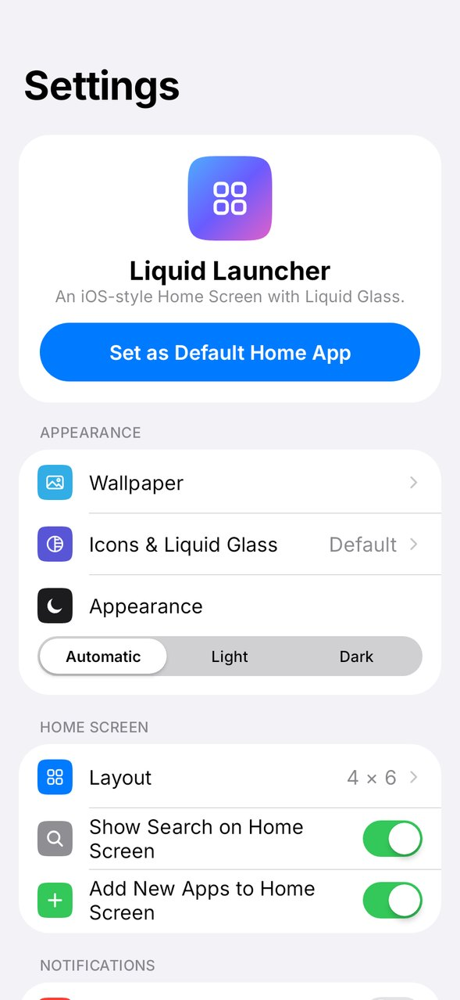
  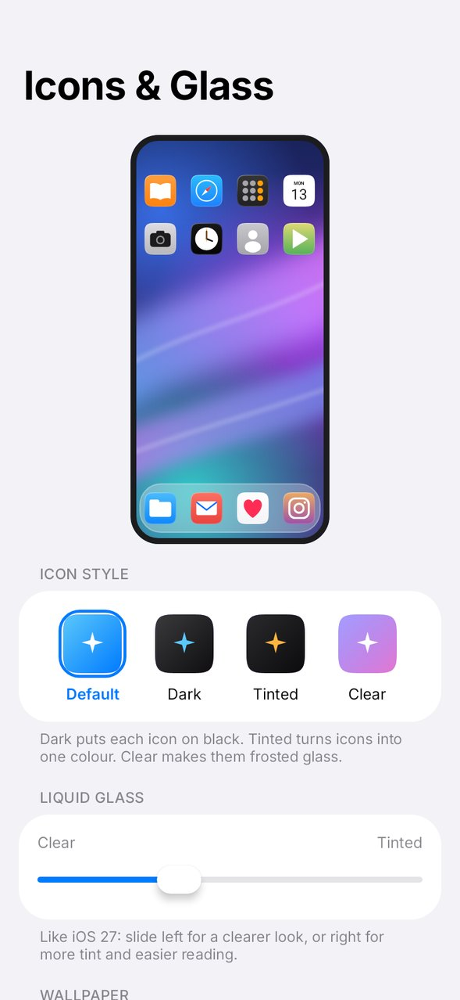
</p>

## Install

1. Get the APK: download `liquid-launcher-apk` from the latest run under the repo's **Actions** tab, or build it yourself (below).
2. Install `app-release.apk` on your phone (allow "Install unknown apps" for your browser / file manager).
3. Open **Launcher Settings** from your app drawer and tap **Set as Home Screen** — or go to *Android Settings → Apps → Default apps → Home app* and pick **Liquid Launcher**.

Requires Android 8.0+. Real Liquid Glass needs Android 12+ (lens effect on 13+).

## Build

```bash
./gradlew assembleRelease        # app/build/outputs/apk/release/app-release.apk
./gradlew testDebugUnitTest      # unit tests + screenshot tests
./gradlew recordRoborazziDebug   # re-render screenshots into app/build/screenshots/
```

The release build is signed with the debug key so it installs straight away; use your own keystore before publishing.

## Project layout

```
app/src/main/java/dev/kidyoh/liquid/
  MainActivity.kt          Home Screen activity (HOME intent)
  SettingsActivity.kt      Onboarding + settings (the app-drawer icon)
  data/                    Apps, layout model & grid packing, edit operations, settings, usage
  icons/                   Squircle shape and icon rendering (Default / Dark / Tinted / Clear)
  wallpaper/               Built-in wallpapers, blur, photo / system wallpaper
  system/                  Launching, shortcuts, badges, default-Home request
  ui/glass/Glass.kt        Liquid Glass (live backdrop + GPU blur + AGSL lens)
  ui/home/                 Pages, dock, drag & drop, folders, menus, edit mode
  ui/library/ ui/today/ ui/search/ ui/widgets/ ui/settings/
```

## Notes

- Screenshots are rendered on the JVM with Robolectric + Roborazzi using stand-in app icons; on your phone you'll see your real apps.
- Third-party Android home-screen widgets aren't hosted yet — only the built-in iOS-style widgets.
- Font: [Inter](https://rsms.me/inter/) (SIL Open Font License, see `licenses/`), the closest open match to SF Pro. Not affiliated with Apple.
